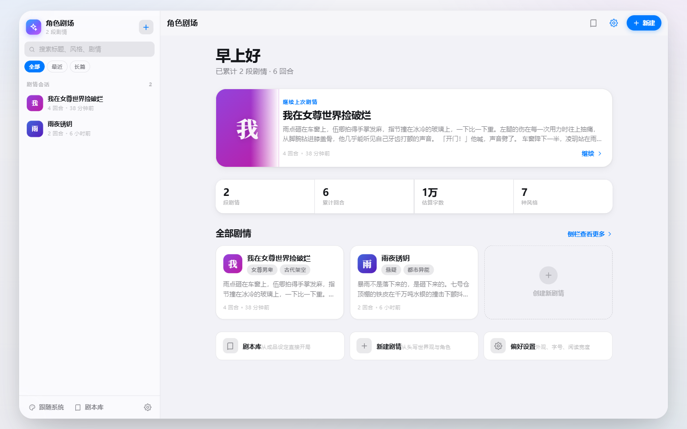
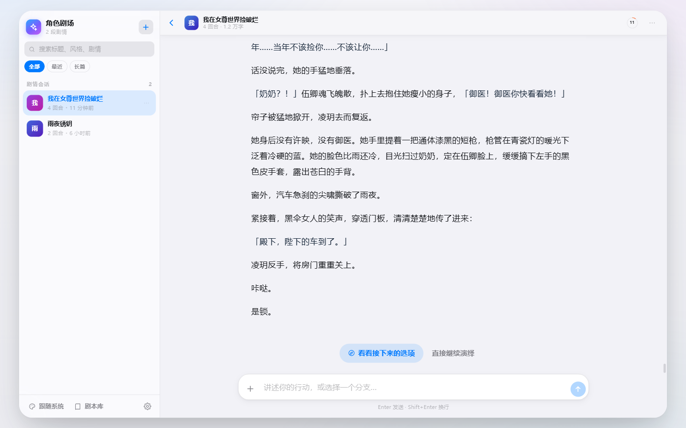
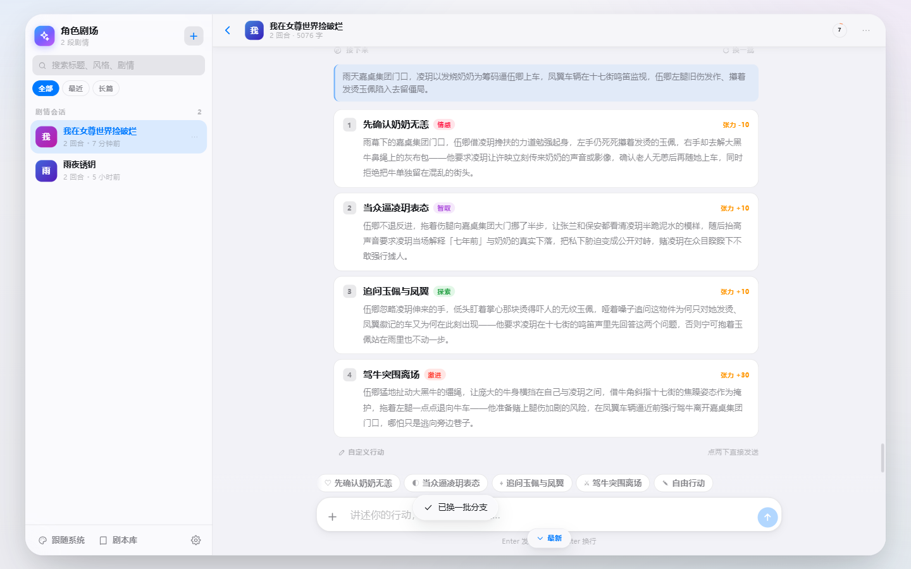
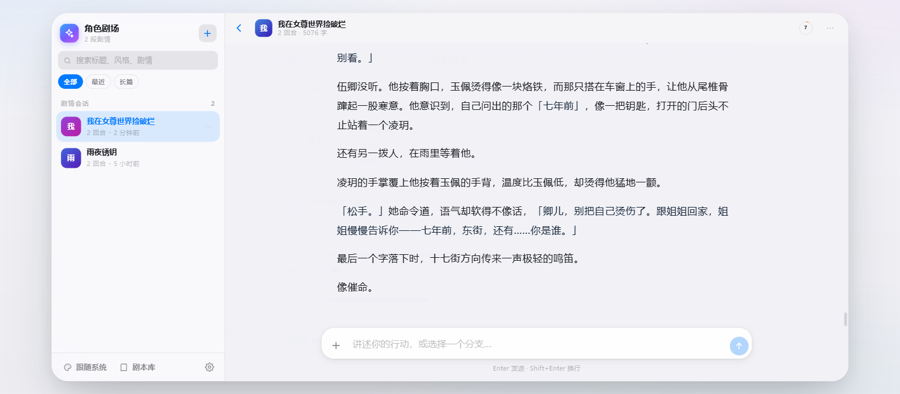
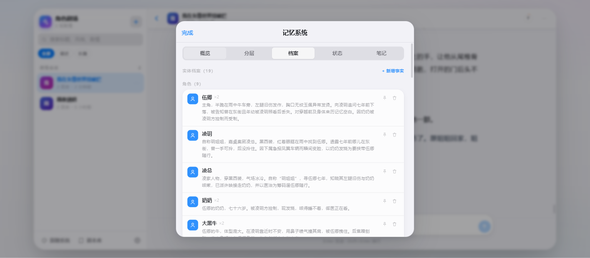
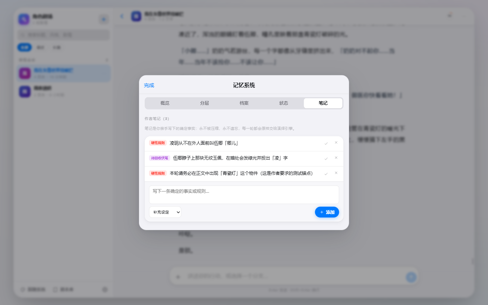
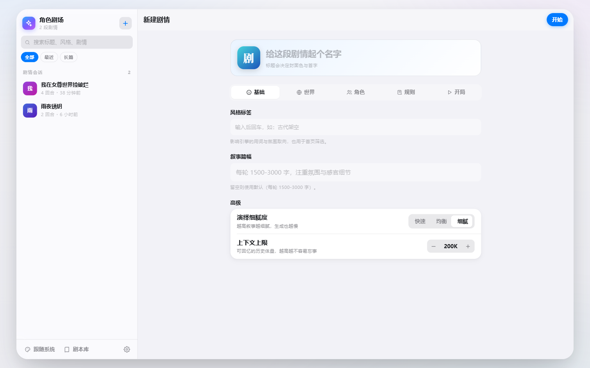
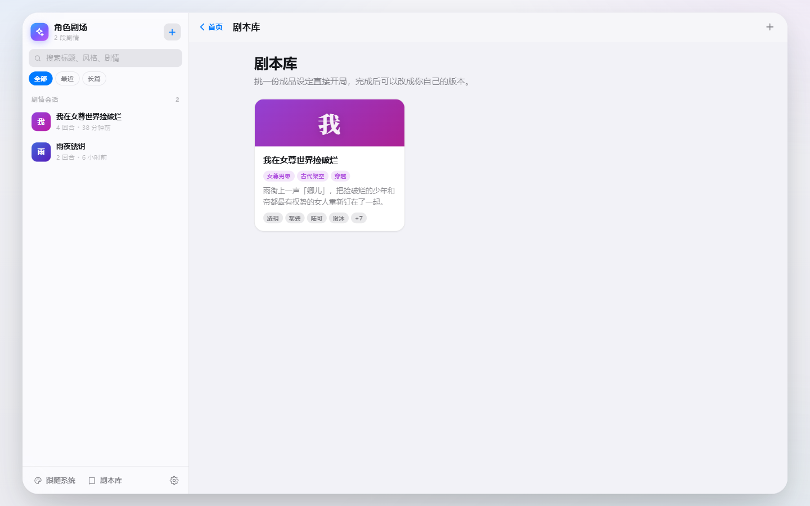
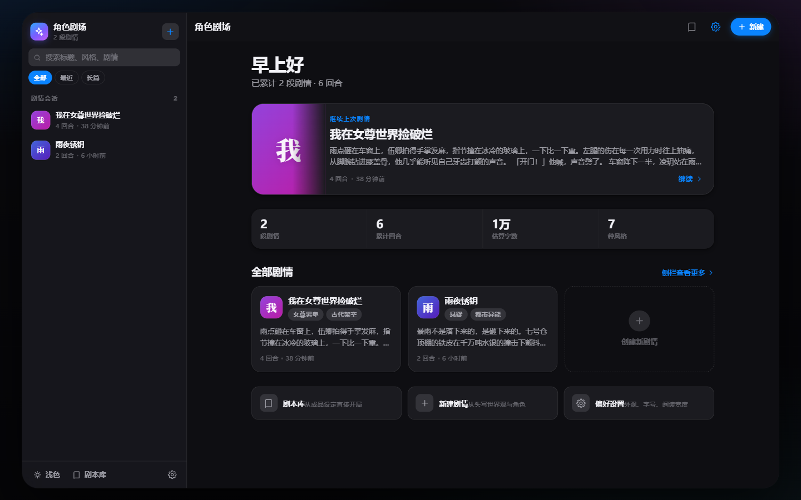
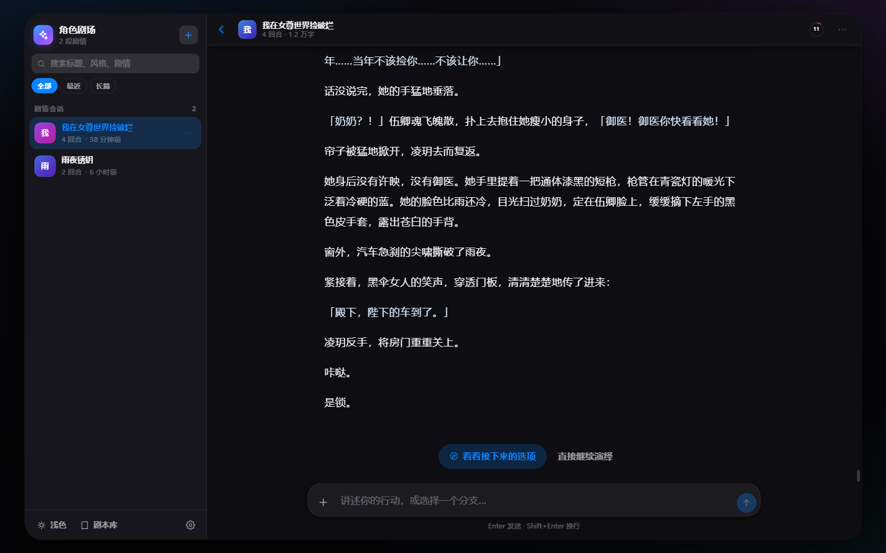

# AI Roleplay Studio

> character.ai 平替 · Apple iOS 美学 · 多 Agent 协同记忆系统 · OpenAI 兼容 API

一个完整的 AI 角色扮演平台：用户提供基础设定（开场白 / 世界观 / 角色 / 扮演规则），**剧情分支 Agent** 提供分支选项（玩家也可自行输入行动），**剧情演绎 Agent** 根据选择演绎每轮数千字的剧情。核心是一套**分层记忆系统**，支持**上千轮剧情不失忆**，同时**上下文始终低于 200K tokens**。

---

## 快速开始

```bash
# 1. 安装依赖（仅 express，Node ≥ 22.5）
pnpm install

# 2. 配置 API Key（已预填，可修改 .env）
#    STEPFUN_API_KEY / STEPFUN_BASE_URL / STEPFUN_MODEL

# 3. 启动
pnpm start          # 或 npm start / node server/index.js

# 4. 打开
#    Web 客户端      http://localhost:3210
#    OpenAI 兼容 API http://localhost:3210/v1
```

---

## 界面

| 首页 | 对话阅读器 |
|---|---|
|  |  |

| 分支选项 | 记忆系统 · 概览 |
|---|---|
|  |  |

| 记忆 · 档案 | 记忆 · 笔记 |
|---|---|
|  |  |

| 设定编辑器 | 剧本库 |
|---|---|
|  |  |

| 深色模式 · 首页 | 深色模式 · 对话 |
|---|---|
|  |  |

| 移动端 · 首页 | 移动端 · 对话 |
|---|---|
|  |  |

---

## 这一版做了什么（v2）

### 一、前端整体重构：从「聊天应用」到「阅读器」

旧版把剧情当聊天记录渲染，每条旁白是一个灰色气泡。问题是：每轮 2000+ 字的正文在窄气泡里读起来像在看群消息，长段落被压成一条细长的视觉通道。

新版按**阅读器**来做：

| 维度 | 旧 | 新 |
|---|---|---|
| 旁白 | 灰色气泡，宽度受限于 78% | 全宽正文，行高 1.88，行宽 40em（可调），衬线字体 |
| 玩家 | 蓝色气泡 | 保留蓝色气泡（这才是真正的「消息」） |
| 回合 | 大号分隔条 | 细线 + 小字，不抢注意力 |
| 导航 | 顶部工具条堆按钮 | 头像 + 标题 + 副标题（回合/字数）+ 记忆环 + 更多 |
| 设定编辑 | 一屏十几个文本框 | 五个分段页签：基础 / 世界 / 角色 / 规则 / 开局 |
| 图标 | emoji（跨平台风格漂移） | 统一 24×24 线性 SVG 图标集（SF Symbols 风格） |
| 主题 | 三份重复的 CSS 变量（light / dark / media query） | 单一令牌文件，JS 解析 system 后写成确定值 |

**设计系统**（`web/styles/`）拆成五个文件，每个只有一个职责：

```
tokens.css   设计令牌（颜色/字号/圆角/阴影/动效/布局）
base.css     reset + 排版 + 基础组件（按钮/表单/分段/开关/分组列表/空态/骨架）
shell.css    壁纸 + 浮动窗口 + 侧栏 + 导航 + 响应式
views.css    首页 / 剧本库 / 设定编辑器 / 设置
chat.css     对话阅读区（正文排版、气泡、分支、输入栏、灯箱）
panels.css   浮层（Sheet / ActionSheet / Dialog / Popover / Toast）+ 记忆面板
```

**交互细节**：

- 卡片、气泡、面板全部用弹簧曲线（`cubic-bezier(.32,.72,0,1)`），按压有 scale 反馈
- 消息进入错峰 30ms，不刷屏
- 流式生成时文字光标闪烁；旁白渲染用 rAF 合并，避免每帧重排
- 思考过程默认收起，流式时自动展开，结束后自动收起
- 分支卡片支持单击选中 / 双击直接发送 / 数字键选择
- 触屏设备上消息操作按钮常驻半透明（无 hover）

### 二、记忆系统增强

分层压缩（L1→L2→L3→L4）沿用原有设计，**新增三层能力**：

#### 1. 作者笔记（确定性记忆）

自动记忆会漂移、会遗忘、会被压缩。有些事实必须**永远准确**——比如「伍卿左腿有旧疾，跑不快」。

笔记是作者亲手写下的确定性记忆：

- **永不被压缩**，独占一个高优先级上下文层（位于摘要之前）
- **永不遗忘**，每轮原样注入
- 四种类型：`补充设定` / `硬性规则` / `待回收伏笔` / `覆盖记忆`
- 可停用（保留但不再注入），用于「这条设定暂时不用了，但以后还要用」

```
上下文装配顺序（优先级从高到低）：
1. system（人设/口吻/规则摘要）
2. bible（世界观 + 角色卡）
3. notes（作者笔记）          ← 新增，高优先级
4. state（剧情状态快照）
5. summaries（L4→L3→L2→L1）
6. entities + facts
7. retrieval（BM25 检索）
8. recent（最近 N 轮原文）
9. current（本轮输入）
```

超预算时的丢弃顺序：`retrieval → 老 summaries → entities → recent → state → notes → bible`。笔记排在倒数第二，只有极端超限才会被舍弃。

#### 2. 记忆可编辑

引擎记错的东西，现在可以手工纠正：

| 操作 | 说明 |
|---|---|
| 固定实体 | 让某个角色/地点/物品永远优先进入上下文，不被预算挤掉 |
| 编辑实体 | 修正档案摘要与重要度 |
| 删除实体 | 错误记忆直接剔除 |
| 新增事实 | 作者钦定的三元组，如「林霜 - 持有 - 生锈的钥匙」 |
| 撤回事实 | 软删除，保留审计痕迹，用于「剧情推翻了旧设定」 |
| 修正状态 | 时间/地点/物品/线索/张力都能手改，纠正跑偏的快照 |

#### 3. 剧情可回滚

- **回到此轮**：删除第 N 轮之后的所有回合与派生记忆（摘要/事实/状态），回到那一刻重新选择
- **重写此轮**：先回滚，再以同样的玩家行动重新演绎，可附加改稿要求（「更压抑一些，不要引入新角色」）
- **编辑正文**：人工改写旁白后，自动用新正文**重建该轮记忆**，保证记忆与正文不分叉

回滚会级联清理：
```
turns (turn_no > N)  →  summaries (turn_to > N)  →  facts (turn_no > N)
                     →  states (turn_no > N)     →  entities.last_turn 修正
```

### 三、新增功能

| 功能 | 说明 |
|---|---|
| **剧本库** | 成品设定（worldview + 角色卡 + 规则 + 开场白）一键开局，也可复制后修改 |
| **会话内全文搜索** | 检索所有回合正文，高亮命中片段，点击跳到对应回合 |
| **分页读取回合** | `GET /turns?from=&to=` 支持长会话按需加载 |
| **导出三种格式** | Markdown（含设定头与记忆附录）/ 纯文本（只留正文，适合阅读器）/ JSON（完整快照，可迁移） |
| **阅读偏好** | 正文字号（15-22px）、行宽（紧凑/标准/宽松）、回合分隔开关、思考过程默认展开 |
| **图片输入 + 灯箱** | 上传参考图给演绎引擎，点击放大查看 |
| **停止生成 / 重试** | 流式中可中断；出错后在消息列表内提供重试按钮 |
| **快捷键** | `⌘K` / `Ctrl+K` 全局搜索，`Enter` 发送，`Shift+Enter` 换行 |
| **压缩比可视化** | 记忆面板直接告诉你「原始剧情 X tok，现在只占 Y tok」，不用理解架构也能看懂价值 |
| **主题三态** | 浅色 / 深色 / 跟随系统，带配色预览卡 |

### 四、剧本实战：《我在女尊世界捡破烂》

把 `素材/我在女尊世界捡破烂/` 的 124 章（27.7 万字）转成了一份可直接开局的剧本预设。

**产出物**：

```
素材/我在女尊世界捡破烂/_分析.md        深度分析（1.1 万字）
presets/nvzun-jianpolan.json             可直接开局的预设
_work/build_preset.py                    可重跑的生成脚本
```

**分析覆盖**：

- 世界观：现代皮囊 + 封建骨架的女尊社会，六条硬规则（婚娶方向、称呼礼法、司楼制度、私兵上限…）
- 角色：伍卿、凌玥、黎婆、陆可、谢沐、姬淮澄、南荣兰冰、凌璇、许映、张兰、姬延、大黑牛（12 位，附台词样本与隐秘动机）
- 剧情结构：10 个篇章弧，标注每弧的核心事件与转折
- 文风：第三人称限知、短句、内心吐槽为主、**清水**尺度
- 开场场景：第 5 章「相遇」的雨街（附 629 字开场白草稿）
- 扮演规则：13 条硬性规则

**几处原文陷阱的规避**（分析文档中均已标注依据）：

- 村名原文从未给出 → 标注为「无名山村」，不擅自命名
- 凌玥年龄原文无直接陈述 → 按第 9 章「她自己也就十六」+ 七年推算，注明依据
- 「系统穿越」标签有误 → 原文明确无金手指、无系统
- 情色尺度 → 全文清水，在 rules 第 10 条锁定

---

## 架构

```
┌────────────────────────────────────────────────────────────────┐
│  Web 客户端（iOS 美学，原生 ESM，无构建）                        │
│  浮动窗口 = 侧栏（会话库/搜索/筛选/外观） + 主区                  │
│  首页 · 对话阅读器 · 设定编辑器 · 剧本库 · 设置                   │
│  毛玻璃 · 大圆角 · 弹簧动画 · 浅色/深色/系统 · 桌面双栏/移动抽屉   │
└───────────────┬────────────────────────────────────────────────┘
                │ 原生 API（SSE）            OpenAI 兼容 API
┌───────────────▼────────────────────────────────────────────────┐
│  Express 服务端                                                 │
│  ┌──────────────┐   ┌──────────────┐   ┌────────────────────┐  │
│  │  Orchestrator│──▶│   Narrator   │   │ 剧情分支 Agent      │  │
│  │  回合管线    │   │  剧情演绎    │   │ 3-4 个分支选项      │  │
│  │  (会话串行锁)│   │  流式输出    │   │                    │  │
│  └──────┬───────┘   └──────────────┘   └────────────────────┘  │
│         │                                                       │
│  ┌──────▼───────────────────────────────────────────────────┐  │
│  │              分层记忆系统（核心）                          │  │
│  │  L1 轮摘要(400tok) → L2 弧摘要(1.5K) → L3 史诗(2.5K)     │  │
│  │  → L4 编年史(5K)   每 5/25/125 轮自动压缩                  │  │
│  │  + 作者笔记(不压缩) + 实体档案 + 事实三元组                 │  │
│  │  + 剧情状态机 + BM25 检索 + 回滚/重写                      │  │
│  │  SQLite 全量归档 · 上下文装配器（预算驱动）                 │  │
│  └───────────────────────────────────────────────────────────┘  │
└────────────────────────────────────────────────────────────────┘
                │
                ▼
        StepFun API（step-5-preview，step_plan 通道）
```

## 前端形态

- **桌面（≥861px）**：iPadOS 风格浮动应用窗口（1360px 上限、28px 圆角），左侧毛玻璃侧栏（296px：品牌 + 搜索 + 筛选 + 会话列表 + 外观/剧本库/设置），右侧主区
- **移动（≤860px）**：全屏单栏，侧栏变抽屉（汉堡唤出 + 遮罩），Toast 移到顶部避免遮挡输入区
- **主题**：浅色 / 深色 / 跟随系统，`localStorage` 持久化，首屏前内联脚本防闪白
- **视图**：`#/`（首页）· `#/chat/:id` · `#/new` · `#/edit/:id` · `#/presets` · `#/settings`

## 多 Agent 协同

| Agent | 职责 | 推理强度 | 输出 |
|---|---|---|---|
| **剧情演绎 Agent** (narrator) | 根据装配好的上下文演绎本轮剧情 | `high` | 1500-3000 字沉浸式叙事（流式） |
| **剧情分支 Agent** (branch) | 基于当前局势生成 3-4 个分支选项 | `medium` | JSON：标题/描述/风格/张力增量 |
| **记忆 Agent** (memory) | 每轮后更新记忆：摘要、实体、事实、状态、压缩 | `low` | L1 摘要 + 记忆更新统计 |

回合流程：`玩家行动/分支选择 → 装配上下文 → 演绎Agent流式输出 → 持久化 → 记忆Agent更新 → 分支Agent生成下一轮选项`。

## 记忆系统：上千轮不失忆，上下文 < 200K

### 分层压缩（5 轮 / 25 轮 / 125 节奏）

| 层级 | 覆盖 | 单条 tokens | 上下文中保留 |
|---|---|---|---|
| L1 轮摘要 | 1 轮 | ~400 | 最近 5 条 |
| L2 弧摘要 | 5 轮 | ~1500 | 最近 8 条 |
| L3 史诗摘要 | 25 轮 | ~2500 | 最近 8 条 |
| L4 编年史 | 125 轮 | ~5000 | 全部（预算内） |

原始档案（每轮 ~2800 tokens）全量存 SQLite；**工作上下文只装压缩表示 + 最近原始轮次**。

### 上下文装配（预算驱动，优先级从高到低）

1. 系统提示词（角色口吻/规则）— 3-8K
2. 世界观 + 角色卡 — 4-12K
3. **作者笔记**（确定性事实，永不压缩）— 不限
4. 剧情状态机（时间/地点/关系/物品/任务/张力）— 1-4K
5. 分层摘要（L4→L3→L2→L1 倒序）— ≤60K
6. 实体档案 + 事实三元组 — ≤12K
7. **BM25 检索历史细节**（CJK bigram，与当前行动相关）— ≤16K
8. 最近 4 轮原始对话 — ~11K
9. 本轮玩家输入（文本 + 图片）

超预算时从低到高丢弃；硬上限 200K（`.env` 可调）。

### 规模验证

```bash
SIM_ROUNDS=1200 node tests/simulate-memory.js
# → 1200 轮后上下文 ~48K tokens（压缩比 ~70 倍）
```

## API

### OpenAI 兼容（`/v1`）

```bash
# 透传模式（无 session_id）
curl $BASE/v1/chat/completions -H "Authorization: Bearer $KEY" -d '{
  "model": "step-5-preview",
  "messages": [{"role":"user","content":"你好"}],
  "reasoning_effort": "medium",     # 推理强调调整：low/medium/high
  "stream": true
}'

# 角色扮演模式（带 session_id，多 Agent 管线 + 记忆系统）
curl $BASE/v1/chat/completions -d '{
  "model": "step-5-preview",
  "session_id": "new",              # 或 'new' + settings 创建新会话
  "settings": {...},                # 首次必需
  "messages": [{"role":"user","content":"我推开门走了进去"}],
  "generate_branches": true,
  "stream": true
}'
```

- 图片输入：user content 用 `[{type:'text'},{type:'image_url',image_url:{url}}]`（http(s) 或 base64 data URI）
- 流式：标准 SSE，`reasoning_content`/`reasoning` 与 `content` 分字段增量下发
- `GET /v1/models` 列出可用模型

### 原生 API（`/api`，驱动 Web 客户端）

**会话与回合**

| 方法 | 路径 | 说明 |
|---|---|---|
| GET | `/api/config` | 模型/默认值/上限 |
| GET/POST | `/api/sessions` | 会话列表 / 创建 |
| GET/PATCH/DELETE | `/api/sessions/:id` | 详情 / 更新 / 删除 |
| POST | `/api/sessions/:id/turn` | 跑一轮（SSE 事件流） |
| POST | `/api/sessions/:id/opening` | 生成开场白（SSE） |
| POST | `/api/sessions/:id/branches` | 重新生成分支 |
| GET | `/api/sessions/:id/turns` | 分页读取回合（`?from=&to=&kinds=`） |
| GET | `/api/sessions/:id/search` | 会话内全文检索（`?q=`） |

**记忆系统**

| 方法 | 路径 | 说明 |
|---|---|---|
| GET | `/api/sessions/:id/memory` | 完整统计（分层/预算/压缩比/实体/事实/笔记/状态） |
| GET/POST | `/api/sessions/:id/notes` | 作者笔记：列表 / 新增 |
| PATCH/DELETE | `/api/sessions/:id/notes/:noteId` | 修改（含启停）/ 删除 |
| PATCH/DELETE | `/api/sessions/:id/entities/:entityId` | 固定/编辑 / 删除实体 |
| POST | `/api/sessions/:id/facts` | 新增作者钦定事实 |
| PATCH/DELETE | `/api/sessions/:id/facts/:factId` | 固定 / 撤回（软删） |
| PUT | `/api/sessions/:id/state` | 人工修正状态快照 |

**剧情编辑**

| 方法 | 路径 | 说明 |
|---|---|---|
| PATCH | `/api/sessions/:id/turns/:turnNo` | 改写正文（`rememorize` 重建记忆） |
| POST | `/api/sessions/:id/rollback` | 回滚到第 N 轮（级联清理） |
| POST | `/api/sessions/:id/rewrite` | 重写某轮（先回滚再重演绎，可带 `guidance`） |

**剧本预设**

| 方法 | 路径 | 说明 |
|---|---|---|
| GET | `/api/presets` | 预设列表（摘要） |
| GET | `/api/presets/:id` | 预设完整设定 |
| POST | `/api/presets` | 写入预设（作者工作流） |

SSE 事件协议：`turn_start` → `reasoning`/`narrative`（增量）→ `narrative_done` → `memory` → `state` → `branches` → `done`。

## 测试

```bash
pnpm test                        # 全部（会启动服务端到端测试）
node tests/test-memory.js        # 记忆系统单元测试（13 项）
node tests/test-memory-v3.js     # 记忆增强单元测试（10 项：笔记/固定/回滚/降级）
node tests/test-agents.js        # Agent + 提示词测试（17 项 mock + 可选真实 LLM）
node tests/test-api-v3.js        # 新增端点集成测试（19 项，需服务已启动）
node tests/integration.js        # 真实 API 端到端（需要 KEY）
SIM_ROUNDS=1200 node tests/simulate-memory.js   # 记忆规模化模拟
```

### 实测结果（2026-10-23，真实 StepFun API）

| 套件 | 结果 |
|---|---|
| test-memory.js | ✅ 13/13 通过 |
| test-memory-v3.js | ✅ 10/10 通过 |
| test-agents.js | ✅ 17/17 mock 通过 |
| test-api-v3.js | ✅ 19/19 通过 |
| simulate-memory.js | ✅ 1200 轮后上下文仅 48,328 tok（24.2% / 200K），压缩比 70× |
| 剧本实战（女尊世界） | ✅ 开场 2309 字、分支 4 个 tone 多样、记忆实体 19 / 事实 26、状态快照字段完整 |

### 剧本实战记录

用 `presets/nvzun-jianpolan.json` 真实跑通了多轮：

| 回合 | 输入 | 输出 | 记忆增量 |
|---|---|---|---|
| 1（开场） | —（以预设 opening 为种子） | 2,309 字 | L1 摘要 + 19 实体 + 26 事实 |
| 2 | 分支「探七年前」 | 1,800 字 | 状态更新、新线索入档 |
| 3 | 分支「带凌玥上车」 | 流式生成 | 张力 + / 关系变化 |

验证要点：
- 世界观一致性：文中出现「嘉桌集团」「东街」「十七街」「凤翼徽记」「司楼」等专有名词，与原文一致
- 角色口吻：凌玥自称「姐姐」、称「卿儿」；张兰骂「小叫花子」；均符合 rules 第 3-4、8 条
- 状态机质量：`time/location/weather/tension/characters/inventory/quests/threads/last_hook` 全部填充
- 分支多样性：4 个选项覆盖「情感/智取/探索/激进」四种 tone

## 配置（.env）

| 变量 | 默认 | 说明 |
|---|---|---|
| `STEPFUN_API_KEY` | — | **必填** |
| `STEPFUN_BASE_URL` | `https://api.stepfun.com/step_plan/v1` | 上游 |
| `CONTEXT_MAX_TOKENS` | 200000 | 上下文硬上限 |
| `RECENT_RAW_TURNS` | 4 | 保留的原始轮数 |
| `RETRIEVAL_TOP_K` | 6 | BM25 检索条数 |
| `ARC_EVERY` / `SAGA_EVERY` / `CHRONICLE_EVERY` | 5 | 压缩节奏 |
| `NARRATOR_EFFORT` 等 | high/medium/low | 各 Agent 推理强度 |
| `NARRATOR_MAX_TOKENS` / `BRANCH_MAX_TOKENS` / `MEMORY_MAX_TOKENS` | 12000 / 5000 / 6000 | 生成上限（step-5-preview 的推理过程计入 max_tokens） |

## 目录

```
ai-roleplay/
├── server/
│   ├── index.js / load-env.js    入口（.env 优先加载）
│   ├── config.js / tokens.js / llm.js
│   ├── agents/               orchestrator · narrator · branch · memory-agent
│   ├── memory/               store(SQLite) · compressor · retriever · assembler
│   ├── prompts/              narrator · branch · memory 提示词
│   └── routes/               openai · sessions · presets · static
├── web/                      iOS 美学前端（原生 ESM，无构建）
│   ├── index.html
│   ├── styles/               tokens · base · shell · views · chat · panels
│   └── js/
│       ├── app.js            路由 + 全局浮层
│       ├── icons.js          SVG 图标集
│       ├── markdown.js       正文渲染
│       ├── api.js / store.js / util.js / export.js / sidebar.js
│       ├── views/            home · chat · editor · presets · settings
│       └── panels/           memory（记忆面板）
├── presets/                  剧本预设（可直接开局）
│   └── nvzun-jianpolan.json  我在女尊世界捡破烂
├── 素材/                     原作素材与深度分析
│   └── 我在女尊世界捡破烂/_分析.md
├── tests/                    单元 + 集成 + 模拟
└── docs/CONTRACTS.md         模块契约
```
