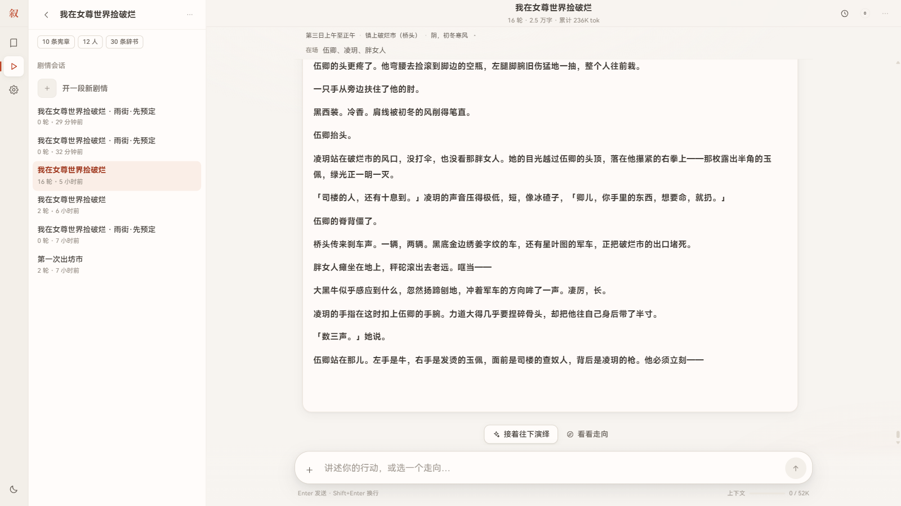

# 场景信息条（playerView）

演绎页顶部的一行只读信息：**时间 · 地点 · 天气**，展开看在场者。
它把账本里已经在演出中出现过的场景信息**投影**给前端，不改变模型上下文。



> 相关契约：`docs/CONTRACTS.md` 的「Orchestrator 接口 / SSE 事件协议 / 场景信息条」。
> 数据形状：`server/agents/archivist.js` 的 `mergeLedger()`（`states.state_json`）。

## 1. 结论先写

- 这是**固定组件**，不是可配置模板：应用提供唯一模板，世界卡作者不写 HTML/CSS/JS。
- 只投影**四个字段**：`time` / `place` / `weather` / `present`。其余账本内容一律不投影。
- 投影必须**在服务端完成**（`server/memory/player-view.js` 的 `buildPlayerView()`）；
  前端只渲染已经过滤好的 `playerView`，不碰完整 `state`。
- 不新增 SSE 事件、不建表、不迁移、不进 `assembleContext`、不占 §6.3 层预算、零模型调用。
- 默认显示摘要行；会话设置 `settings.status_bar = 'off'` 时整条隐藏。

## 2. 为什么不是「AI 更新变量 → 前端预置模板渲染」

这是 Storyteller / SillyTavern 生态的 MVU + 状态栏模式：卡作者在消息里嵌
`<UpdateVariable>` 补丁，前端用正则把 `<StatusPlaceHolderImpl/>` 替换成自带
`<style>/<script>` 的 iframe HTML。本项目**不采用**，四个理由（按重要性）：

1. **输入面纪律**：这会引入第二种作者输入面（HTML/JS），绕过 Card Schema 的校验与投影。
   架构红线只允许「世界卡模板 + 确定性代码」这一条输入面；新增输入面必须整体重新论证。
2. **安全**：iframe 里跑的是卡作者提供的脚本/HTML。即使 `sandbox`，也要长期维护
   CSP、外链、字体、脚本逃逸面；叙事台没有这个维护预算。
3. **数据反转**：MVU 让 UI 变量成为第二真相源。本项目账本是史官的**概率性抽取**，
   常驻展示会把「模型可能记错的东西」抬成与正文同等的「既定事实」。
4. **不需要**：状态条要展示的信息（时间/地点/天气/在场）每一种卡都有，属于固定结构，
   不需要作者自定义；自定义带来的收益（换皮）远小于风险。

如果未来真要兼容 ST 生态，那是一个独立的**导入器 + 沙箱**项目，不是本仓库的前端约定。

## 3. 数据契约

```js
// server/memory/player-view.js（纯函数，不读库、不调模型）
buildPlayerView(ledger, { persons }) -> { time, place, weather, present: string[] }
```

- `time/place/weather`：字符串，空值归一为 `''`。
- `present`：来自账本 `present[]`（史官写名字，锚点快照写卡司 id），
  按卡司 `id / name / aliases` 归一成**显示名**后去重；不在卡司里的原样保留。
- 白名单写死在模块里。**不要**把 `characters` / `inventory` / `quests` / `tension` /
  `last_hook` / `theme_tags` 加进来：心境、目标、私人物品会剧透，概率性抽取会变成假事实。

暴露方式（两处，同一个投影）：

| 通道 | 位置 | 字段 |
|---|---|---|
| HTTP | `GET /api/sessions/:id` | `playerView` |
| SSE | 每轮 `memory` 之后的 `state` 事件 | `player_view`（同响应的 `state` 仍是完整账本，仅供导出/排查） |

前端：`web/js/views/play.js` 的 `paintStatusBar()`；样式 `.status-strip` 在 `chat.css`。
默认收起，点摘要行展开在场者；`settings.status_bar === 'off'` 隐藏（开关在「更多」菜单）。

## 4. 扩展规则（以后想加字段时）

1. 先回答 §0 四问：这个字段是**所有卡**都有的固定结构，还是某张卡的私房信息？
   后者一律走记忆面板，不进状态条。
2. 只改 `player-view.js` 白名单 + `docs/CONTRACTS.md`；**不要**改 `assembleContext`，
   也不要顺手把它塞进提示词。
3. 若字段来自卡司/辞书，必须确认它在正文里已经出现过（`reveal` 相关字段不投影）；
   过滤在服务端做，前端过滤等于已经泄露。
4. 补测试：`tests/test-memory.js` 白名单/不投影断言；涉及 HTTP 时补 `tests/test-api.js`。
5. 状态条是**只读、不可交互**的。需要操作（整理物品、看任务）走记忆面板，不要把它做成
   第二个游戏界面。

## 5. 测试清单

- 白名单只有 `time/place/weather/present` 四个键。
- 账本细节（心境 / 目标 / 物品 / 任务 / 张力 / last_hook / theme_tags）不出现在序列化结果里。
- `present` 的 id/别名归一成显示名并去重；不在卡司里的名字原样保留。
- 空账本 / 非对象输入不抛错。
- `GET /api/sessions/:id` 返回 `playerView`，且不包含人物心境。
